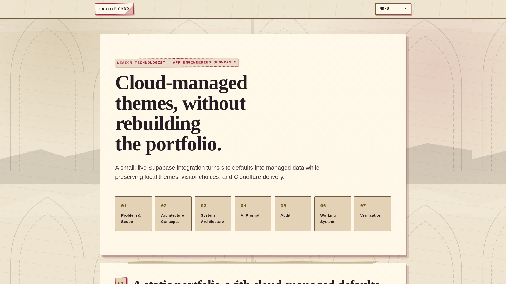
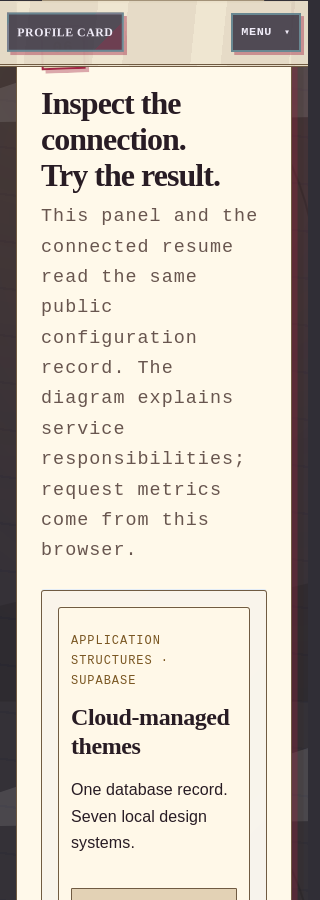

<div align="center">

<h1>☁️🎨 Cloud-Managed Themes</h1>
<p><strong>Small cloud settings. Big personality. Local rendering.</strong></p>
<p>🧩 App Engineering Showcases · 🗄️ Supabase · ⚡ Vanilla JavaScript · 🌗 Seven local themes</p>

</div>

## 🎯 Project Description

**Application analyzed:** Supabase, focusing on the boundary between its PostgreSQL database, PostgREST/Data API, and a browser client—not the entire platform.

**Prototype built:** a standalone Cloud-Managed Themes showcase. One public database record supplies appearance defaults and menu order; the browser validates them, respects visitor choices, and renders seven local theme packages. The prototype demonstrates cloud-managed settings **without handing rendering over to the backend**.

> 🧭 **This folder contains the standalone showcase—not the Resume or the other showcase pages.** The linked live demonstration is the original portfolio edition. The included QA and Lighthouse reports tested **that live website**, not this standalone copy.

**Jump in:** [🎬 Video](#video) · [🚀 Run locally](#quick-start) · [🏗️ Architecture](#architecture) · [🧪 QA results](#qa) · [📚 Reports](#reports) · [🤖 AI workflow](#ai)

---

<a id="video"></a>
## 🎬 Lights, camera… demonstration!

| Submission item | Link | Status |
| :--- | :--- | :--- |
| 🎥 YouTube demonstration — 5–7 minutes, screen + webcam throughout | **Pending recording/upload** | ⏳ Add the real YouTube URL after upload |
| 🌍 Live portfolio showcase | [Open Cloud-Managed Themes](https://chernichenkodmitriy.com/showcases/cloud-managed-themes/) | 🔗 Original live edition |
| 🧪 QA findings | [Read the full report](docs/qa/qa-report.md) | ⚠️ Completed with findings |
| 🏠 Standalone application | [Open the source entry point](index.html) | 💻 Serve locally using the instructions below |

**Recording route:** architecture diagram → database settings → live GET response → visible theme change → QA evidence → engineering reflection.

<details>
<summary>🎞️ A simple recording outline</summary>

| Time | What to show |
| :--- | :--- |
| **0:00–2:00** | Explain the architecture diagram and a genuine AI correction: a catalog-only idea was refined into settings that actually control defaults and ordering. |
| **2:00–4:00** | Show the public settings row, clear your personal overrides, make an intentional administrator change if appropriate, then reload configuration and show the matching JSON and rendered appearance. |
| **4:00–6:00** | Show Network/Console, responsive views, search edge cases, keyboard navigation, and the actual Lighthouse reports. Acknowledge the remaining findings. |
| **6:00–7:00** | Explain the trade-off: remotely editable defaults add flexibility, but introduce a network dependency that needs validation and fallback. |

🔐 Sign in before recording. Do not show passwords, privileged keys, or authentication tokens. Administrative database edits change the live defaults; restore the intended defaults afterward. Keep the screen and webcam visible throughout.

</details>

<a id="quick-start"></a>
## 🚀 Setup & Run Instructions

**Needed:** Python 3 and a modern browser. **Not needed:** npm installation, a build framework, or a new backend server.

### 📦 1. Get the project

For the standalone edition, use the supplied **Cloud-Managed-Themes** folder and open a terminal there. No separate standalone GitHub clone URL has been established.

To obtain the **original portfolio source** instead, authorized collaborators can clone its private repository:

```bash
git clone https://github.com/Chernichenko-Dmitriy/Chernichenko-Dmitriy.github.io.git Portfolio-Source
```

That command gets the complete portfolio, **not** this extracted standalone folder. If serving the cloned portfolio root, its showcase route is `/showcases/cloud-managed-themes/`. The remaining standalone instructions assume you are inside **Cloud-Managed-Themes**.

### 🔌 2. Configure the browser connection

**Environment variables: none are required or read by this static application.** A `.env` file or exported `SUPABASE_URL` will not configure it automatically. The browser reads `theme-cloud-config.js` instead:

```js
window.PortfolioThemeCloudConnection = Object.freeze({
  projectUrl: 'https://YOUR_PROJECT_REF.supabase.co',
  publishableKey: '<YOUR_SUPABASE_PUBLISHABLE_KEY>'
});
```

The values above are **placeholders**, not working credentials. Retain the supplied public connection settings to use the existing demonstration, or replace both fields with your own project's URL and **publishable** key. For your own database, review and intentionally run [setup.sql](setup.sql) as an administrator first; it creates the settings record and read-only browser access. Do not run it against an unrelated project.

🔐 Never place a secret/service-role key or database password in this file. Without a reachable valid connection, the page can fall back to validated cached or bundled settings; that is not proof of a live connection.

### ▶️ 3. Run locally

From the standalone project folder:

```bash
python3 -m http.server 8769 --bind 127.0.0.1
```

On systems where Python 3 is named `python`, use `python` instead of `python3`. On Windows, `py -m http.server 8769 --bind 127.0.0.1` is another option.

| Open this | Local address |
| :--- | :--- |
| 🎨 Standalone application | <http://127.0.0.1:8769/> |
| 🧪 QA dashboard | <http://127.0.0.1:8769/docs/qa/qa-report.html> |
| 🖥️ Desktop Lighthouse report | <http://127.0.0.1:8769/docs/qa/lighthouse/lighthouse-desktop.report.html> |
| 📱 Mobile Lighthouse report | <http://127.0.0.1:8769/docs/qa/lighthouse/lighthouse-mobile.report.html> |

> 💡 Use HTTP rather than opening `index.html` through `file://`. The reports can be opened as downloaded HTML files, but serving the folder is the easiest way to browse everything together. GitHub may show an HTML report as source rather than its interactive view.

### 🕹️ Things to try

- **Reload from Supabase:** fetch the current public configuration.
- **Preview a theme + switch color mode:** your explicit choices override their corresponding defaults.
- **Use cloud defaults:** clear current-page overrides and remove saved choices when browser storage permits.
- **Find a theme:** try `luminous`, an empty search, or a name that does not exist.
- **Simulate offline fallback:** exercise the clearly labeled simulation; it does not disconnect or modify Supabase.

To reset both appearance choices and fetch the current defaults from DevTools Console:

```js
await window.portfolioThemeCloud.useCloudDefaults();
await window.portfolioThemeCloud.reload();
```

<a id="architecture"></a>
## 🏗️ Meet the architecture

```text
🌐 Static host ── HTML / CSS / JavaScript / assets ──▶ 🖥️ Browser
                                                        │
                                                        ├── HTTPS GET ──▶ 🗄️ Supabase Data API
                                                        │                    │ PostgREST
                                                        │                    ▼
                                                        │                PostgreSQL
                                                        ◀── settings JSON ───┘
                                                        │
                                  🛡️ Validate + resolve visitor preferences
                                                        │
                                                        ▼
                                          🎨 Local theme packages render
```

**Architectural style:** a statically delivered browser client consuming a managed REST/database service. The assignment examines a narrow Supabase-backed feature—not a clone or deployment of the entire Supabase platform.

| Piece of the puzzle | Its job |
| :--- | :--- |
| 🌐 Static host | Deliver the application files. The original live edition uses Cloudflare; localhost uses Python's HTTP server. |
| 🗄️ `public.portfolio_theme_settings` | Store `default_theme`, `default_mode`, and `theme_order` in one public configuration row. |
| 🚦 Supabase Data API / PostgREST | Expose permitted queries. SELECT grants and row-level security restrict browser access. |
| 🛡️ `theme-cloud.js` | Read and validate settings, handle request ownership/timeouts, resolve preferences, and choose cache or bundled fallback. |
| 🎨 `theme.js` + `styles/themes/` | Apply installed theme CSS, metadata, visual assets, and light/dark mode. |
| 🧭 `site-navigation.js` + `showcase.js` | Provide standalone section navigation, appearance controls, and observable request information. |
| 💾 Browser storage / page memory | Keep visitor choices when possible; provide current-page choices when storage is restricted. |

**The important boundary:** Supabase returns **configuration JSON**, not CSS, executable JavaScript, or theme assets. The architecture diagram explains responsibility; the Working System reports observations from actual browser requests.

### 🧩 Seven sections, one engineering story

**Problem & Scope → Architecture Concepts → System Architecture → AI Prompt → Audit → Working System → Verification**

The AI Prompt section follows **Review → Plan → Build → Verify**, with copyable guidance and the implementation specification.

### 🔐 Public settings, private secrets

The browser uses a **publishable client key**, not a privileged secret. The permission design is read-only for browser roles: no public INSERT, UPDATE, or DELETE path. A successful GET alone does **not** prove write restrictions.

For a separate Supabase project, review [the complete setup SQL](setup.sql), run it intentionally as an administrator in the intended project, and configure only the project URL and publishable key in `theme-cloud-config.js`. Never put service-role keys, database passwords, or GitHub/OpenAI tokens in frontend files.

**Deliberate non-goals:** visitor accounts, a public administrator editor, cross-device preference sync, remote CSS delivery, and self-hosting Supabase.

<a id="qa"></a>
## 🧪 The QA lab — real results, no pretend green lights

> ⚠️ **Completed with findings.** The normal live flows work, but the full checklist is not all green and this is not an accessibility certification.

| Audit detail | Recorded value |
| :--- | :--- |
| 🌍 Tested target | <https://chernichenkodmitriy.com/showcases/cloud-managed-themes/> |
| 🧬 Tested portfolio commit | `4cef72a7136d72f5e44d902c89d7465f49702b05` |
| 🗓️ Lighthouse capture | **October 19, 2026 UTC** — October 18 in Pacific time |
| 🔦 Lighthouse version | **13.5.0** |
| 🦊 Browser engines | **Chromium 148.0.7778.96** and **Firefox 158.0** |
| 📐 Responsive coverage | **126** theme/mode/viewport combinations passed page-overflow checks: 70 Chromium + 56 Firefox |

### 🔦 Lighthouse scoreboard

| Profile | ⚡ Performance | ♿ Accessibility | 🛠️ Best Practices | 🔎 SEO | Open the report |
| :--- | ---: | ---: | ---: | ---: | :--- |
| 🖥️ Desktop | **98** | **96** | **100** | **100** | [Desktop HTML](docs/qa/lighthouse/lighthouse-desktop.report.html) · [JSON](docs/qa/lighthouse/lighthouse-desktop.report.json) |
| 📱 Mobile | **80** | **96** | **100** | **100** | [Mobile HTML](docs/qa/lighthouse/lighthouse-mobile.report.html) · [JSON](docs/qa/lighthouse/lighthouse-mobile.report.json) |

| Measured metric | 🖥️ Desktop | 📱 Mobile |
| :--- | ---: | ---: |
| First Contentful Paint | 0.8 s | 2.4 s |
| Largest Contentful Paint | 0.9 s | 2.6 s |
| Total Blocking Time | 30 ms | 560 ms |
| Cumulative Layout Shift | 0.048 | 0 |

These are **single-run lab measurements**, not field Core Web Vitals or a promise of identical results on every device. Mobile uses simulated throttling. No scores were changed or rounded up to suggest a clean bill of health.

### ✅ What worked on the live site

- Real Supabase reads returned **HTTP 200**.
- Theme/mode selection, persistence, reset, search edge cases, and labeled fallback recovery worked in both engines.
- Responsive checks included exact **1920×1080**, **768×1024**, **390×844**, and **320×900** viewports; Chromium also included **1440×1000**.
- No uncaught **website JavaScript errors** were captured.
- Focused Tab/Enter/Escape follow-ups passed. Earlier timing/focus failures remain in the evidence.
- Copy controls were checked against the actual prompt/SQL text in the Chromium live run.

### 🛠️ Still on the workbench

| Finding | What remains |
| :--- | :--- |
| 🎨 **QA-01 · Text contrast** | Seven process numbers measure about **4.4:1**, below the applicable **4.5:1** threshold in the audited default theme. |
| 🗣️ **QA-02 · Accessible name** | The selected theme button visibly says **Selected**, but its accessible name says **Preview Gothic Stickerboard**. |
| ⌨️ **QA-03 · Scrollable prompt** | The build-prompt code region needs a suitable keyboard-focus target. |
| 🖼️ **QA-04 · Missing favicon** | Firefox requests `/favicon.ico`, which returns **404**. The zero-broken-assets criterion is not yet met. |
| ⏱️ **QA-05 · Controlled timing test** | The held-metadata/newer-GET scenario still fails and needs investigation. Its controlled responses are **not** a failed normal live Supabase read. |

**Read the full story:** [QA report — Markdown](docs/qa/qa-report.md) · [QA report — visual dashboard](docs/qa/qa-report.html) · [Machine-readable summary](docs/qa/summary.json)

<details>
<summary>📸 Peek at the live-site evidence</summary>

**Desktop · Chromium · 1920×1080**



**Narrow mobile · Firefox · 320px**



</details>

<a id="reports"></a>
## 📚 Evidence shelf

| Artifact | Why open it? |
| :--- | :--- |
| [🧪 Full QA report](docs/qa/qa-report.md) | Rubric coverage, reproductions, recommendations, and limitations. |
| [🖥️ Desktop Lighthouse](docs/qa/lighthouse/lighthouse-desktop.report.html) | Interactive desktop audit with all findings. |
| [📱 Mobile Lighthouse](docs/qa/lighthouse/lighthouse-mobile.report.html) | Interactive mobile audit and performance metrics. |
| [🧾 Evidence index](docs/qa/README.md) | Guide to the copied reports and raw evidence. |
| [♿ Chromium axe details](docs/qa/axe-chromium.json) · [Firefox axe details](docs/qa/axe-firefox.json) | Specific affected elements and accessibility rule failures. |
| [⌨️ Keyboard follow-up](docs/qa/chromium-keyboard-followup.json) | Actual focus checks at four widths. |
| [📦 Bundle manifest](docs/qa/bundle-manifest.json) | Checksums linking these copies to the original evidence. |

The bundle preserves failed attempts and follow-ups; it does not overwrite the audit history. Temporary npm dependencies and browser profiles are **not included**. Original machine paths inside raw evidence are provenance, not required paths for opening the relative report links here.

### 🧰 Local checks you can run

From this project folder:

```bash
python3 -B tests/contract.py
node --test tests/cloud-themes.test.cjs
```

The first command checks the standalone file/section/dependency contract. The second runs the core configuration logic tests and requires Node.js. Neither command is a substitute for the full browser checklist. The included [browser smoke script](tests/browser_smoke.py) requires an existing compatible Playwright installation and a running local server.

🧪 **Local documentation-integration check:** all **5 structural checks** and **20 core unit tests** passed after the reports were added. This is a limited local check—not a standalone Lighthouse or full-browser certification.

**Scope reminder:** the imported browser and Lighthouse results belong to the **live portfolio edition**. A completed standalone browser/Lighthouse audit is not claimed by copying those reports here.

<a id="files"></a>
## 🗂️ What's in the box?

```text
Cloud-Managed-Themes/
├── README.md                 📖 You are here
├── index.html                🎨 Standalone showcase
├── showcase.js               🕹️ Live controls and observations
├── site-navigation.js        🧭 Standalone section navigation
├── theme.js                  🌗 Local theme controller
├── theme-cloud.js            ☁️ Validated configuration and fallback
├── theme-cloud-config.js     🔑 Public browser connection settings
├── copy-code.js              📋 Copy controls
├── setup.sql                 🗄️ Full database setup and permission checks
├── AI-PROMPTS.md              🤖 Preserved prompt/provenance record
├── styles/
│   ├── shared/               🧱 Shared layout and navigation styling
│   ├── themes/               🎭 Seven local theme packages + registry
│   └── cloud-managed-themes.css
├── tests/                    🧪 Structural, unit, and browser checks
└── docs/qa/                  🔦 QA + Lighthouse reports and evidence
```

<a id="ai"></a>
## 🤖 AI Prompt & Verification

**Review → Plan → Build → Verify.** Use AI in small steps, inspect the result, and request focused corrections. The [website's AI Prompt section](https://chernichenkodmitriy.com/showcases/cloud-managed-themes/#prompt-title) contains the full prompts and implementation specification.

Short excerpts already displayed there:

- 🔍 **Review:** “Review the attached portfolio files before editing.”
- 🧪 **Verify:** “Separate live observations from controlled tests.”
- 🛑 **Be honest:** “Never invent a successful response or test result.”

The website's **Audit** checks read-only access, response validation, visitor preferences, and honest failure handling. Its **Verification** section covers reload, reset, search, keyboard access, and narrow layouts.

### 💭 The engineering takeaway

Cloud-managed defaults are flexible—but the network should not own the ability to render. Keep settings validated, theme assets local, visitor choices authoritative in their own dimensions, and failures honest. AI can accelerate the build; it cannot replace verifying those boundaries.

## 🧭 Follow the source trail

- [Supabase architecture](https://supabase.com/docs/guides/getting-started/architecture)
- [Supabase row-level security](https://supabase.com/docs/guides/database/postgres/row-level-security)
- [Supabase API keys](https://supabase.com/docs/guides/getting-started/api-keys)
- [MDN: Fetch API](https://developer.mozilla.org/en-US/docs/Web/API/Fetch_API)
- [MDN: localStorage](https://developer.mozilla.org/en-US/docs/Web/API/Window/localStorage)
- [MDN: AbortController](https://developer.mozilla.org/en-US/docs/Web/API/AbortController)

---

<p align="center"><strong>☁️ Cloud sets the defaults. 🎨 Local code paints the picture. 🧪 Evidence keeps us honest.</strong></p>
